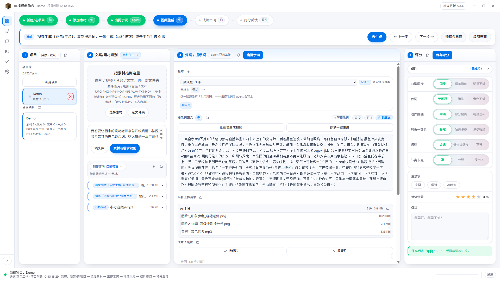

<div align="center">


# HeronBo · AI Video Prompt Studio

**Turn scripts and assets into production-ready video prompts.**

[](CHANGELOG.md)
[](#)
[](#)
[](LICENSE)

Write prompts · Deconstruct reference videos · Six-dimension review · Improve every round

**English | [简体中文](README.zh-CN.md)**

</div>

---

## What it is

A video-prompt workflow for agents. It reads your script and assets (image / video / audio / text), then produces prompts that can be pasted directly into Jimeng, Seedance and similar platforms. Every finished clip is scored and fed back into the rules, so the next prompt is more accurate.

It also ships with a Windows desktop studio: four-column workflow board, Doubao and Jimeng generation channels, clip scoring, and online updates.



**What it does not do**

- It only writes prompt text. It does **not** submit generations or spend credits for you; you press the final button on the platform.
- If you ask it to submit on your behalf, it quotes the cost first, waits for your confirmation, then reports the actual consumption.
- Deliverables never contain internal command lines, unit prices, or queue details.

## Install

The easiest way is to give the repository link to your agent:

```text
Install this skill: https://github.com/heronbo111/HeronBo-AIGC-Prompt
```

Or use npm:

```bash
npm i -g heronbo-aigc-prompt

# npm 11+ does not run postinstall by default; allow it once:
npm i -g --allow-scripts=heronbo-aigc-prompt heronbo-aigc-prompt

# Custom skill directory:
HERONBO_SKILL_DIRS="D:/somewhere/skills" npm i -g heronbo-aigc-prompt
```

Or install manually:

```bash
git clone https://github.com/heronbo111/HeronBo-AIGC-Prompt.git
cd HeronBo-AIGC-Prompt
mkdir -p ~/.zcode/skills/heronbo-aigc-prompt
cp -r SKILL.md references samples tools ~/.zcode/skills/heronbo-aigc-prompt/
```

For users in mainland China, a Gitee mirror is available:

```bash
git clone https://gitee.com/HeronBo/HeronBo-AIGC-Prompt.git
```

> No git? Download the source ZIP:
> `https://gitee.com/HeronBo/HeronBo-AIGC-Prompt/repository/archive/main.zip`,
> unzip it, then run `python 安装向导.py`.

### Desktop Studio

Download the full installer from [Releases](https://github.com/heronbo111/HeronBo-AIGC-Prompt/releases) (about 620 MB, all dependencies bundled, works offline):

| File | Purpose |
|---|---|
| `HeronBo-Workbench-Setup-v*.exe` | Fresh install / reinstall |
| `HeronBo-Workbench-Portable-v*.zip` | Extract and run; no registry writes |
| `HeronBo-Workbench-Update-v*.zip` | Used by “Check for Updates”; usually not needed manually |

The installed app bundles Python, Node, ffmpeg and models. No separate development environment is required.

## Where to install the skill

| Agent | Skill directory |
|---|---|
| ZCode | `~/.zcode/skills/heronbo-aigc-prompt/` |
| Claude Code | `~/.claude/skills/heronbo-aigc-prompt/` |
| Codex CLI | `~/.codex/skills/heronbo-aigc-prompt/` |
| DeepSeek Harness (DSH) | `~/.dsh/skills/heronbo-aigc-prompt/` |
| WorkBuddy / agents | `~/.agents/skills/heronbo-aigc-prompt/` |
| Doubao Work (Enterprise) | `%LOCALAPPDATA%\DoubaoWork\User Data\<profile>\.doubaowork\agent_mode\workspace\.user_skills\heronbo-aigc-prompt\` |

`~` means `C:\Users\your-name`. Doubao Work may have several profiles; the one actually in use is not always called `Default`. Installing into the wrong profile means the skill will not be found.

Verify the installation:

```bash
python tools\环境检查.py        # check runtime and optional dependencies
python tools\首次配置.py        # exit 0 if configured, exit 1 if not
```

## Usage

Just say what you need; no command memorization required.

| You say | What happens |
|---|---|
| Turn this script into a Seedance prompt | Clarifies visual anchors and constraints first, then returns a paste-ready prompt plus an asset list |
| Animate this image | Uses the image as the only anchor; writes motion / camera / style and suggests parameters and first/last frames |
| Follow this video’s camera work | Deconstructs the reference video’s motion and rhythm, then writes a new prompt with the same camera language |
| Replace the person in this video | Keeps motion and composition, swaps only the subject; rates difficulty L1–L4 first |
| Break down this viral remix | Three reading questions + machine evidence (frame extraction / transcription) + deconstruction report + reproduction path |
| Score the finished clip | Opens the six-dimension review (lip sync / dialogue / motion / character / pacing / beat sync); the result is written back to the project and into the rules |

## Capabilities

| Category | Typical request |
|---|---|
| **Image-to-video** | Animate a still; prop / subject replacement |
| **Text-to-video** | No assets, only a written description |
| **Reference-video-to-video** | Follow a reference video’s camera, motion or rhythm |
| **Reference-video replacement** | Keep the original motion and composition, replace the person or object |
| Music remix | Beat sync / lip sync (a special case of reference-video work) |

Additional capabilities: **clip deconstruction**, **feedback loop** (each score becomes a rule for the next round), **model-agnostic** (the same prompt works across Jimeng / Xiaoyunque / updream).

## Repository layout

```text
SKILL.md              Skill body (the agent can work from this file alone)
references/           Rules: platform parameters, model limits, deconstruction rubrics, playbooks
samples/              Sample projects and review data (anonymized)
tools/                Asset recognition, deconstruction, scoring and deployment scripts
docs/                 Deployment and onboarding docs
npm/                  npm distribution of the skill layer
CHANGELOG.md          Release history
```

## Troubleshooting

**Antivirus deleted the exe** — the app has no code-signing certificate, so new builds are often flagged. Run `python tools\deploy.py defender --yes` (click “Yes” on UAC), then restore it from Windows Security → Protection History.

**Blank window** — the WebView2 runtime is broken. `python tools\部署.py check` reports it; `python tools\部署.py wx --yes` repairs it. The studio also falls back to an Edge window automatically.

**Let the studio call the local agent** — it needs a headless-callable channel (WorkBuddy / ZCode / Doubao Work / Claude Code / Codex / DSH). Copy the task from `docs/新机部署.md` to your agent, or use “Copy bridge task” in the studio’s “Agent Channel” dialog.

**It says the project library is not configured** — the project library is the directory that holds all projects. Pick it once on the “Setup” page; it is stored locally in `references/paths.local.md` (never committed or uploaded).

**“Check for Updates” finds a version but cannot install** — 0.6.2 and earlier were single-file builds. Install one full package manually; online updates work after that.

**Does Jimeng consume credits?** — Yes. “Generate with Jimeng” quotes the cost before submitting, and only deducts after you confirm; afterwards it reports the spend from the balance difference. If you only want to save credits, use it for prompt writing.

**Python scripts do not run** — Python 3.9+ is required. Run `python tools/环境检查.py` to see what is missing; the installed studio bundles its own runtime.

## Contributing

1. Use it and send feedback: clip feedback and six-dimension scores are the only source of rule updates.
2. Keep local changes in `references/*.local.md` (gitignored), so `git pull` never conflicts.
3. Large videos (final clips / discarded clips) never enter the repository; real data stays in your local project library.

## License

[MIT](LICENSE)

## Changelog

See [CHANGELOG.md](CHANGELOG.md); the current version is in the `version` field of `SKILL.md`.
