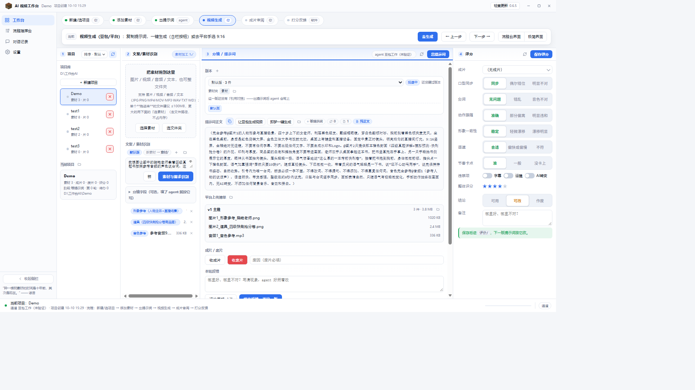

<div align="center">


# HeronBo・AI 视频提示词

**把文案和素材，变成一段可以直接粘贴的生成指令。**

[](CHANGELOG.md)
[](#)
[](#)
[](LICENSE)

写视频提示词 · 拆解二创成片 · 六维评分复盘 · 越用越准

</div>

---

## 这是什么

给 agent 的一套视频提示词工作法：读你的文案与素材（图片 / 视频 / 音频 / 文本），产出**可以直接粘进即梦、Seedance 等平台生成框**的提示词，并把每次成片的评分沉淀成规则，下一轮写得更准。

它同时带一个 Windows 图形工作台：四栏流程板、豆包与即梦两条生成通道、成片评分、在线更新。



**它不做什么**（硬规矩）：

- 只产出提示词文字，**不替你提交生成、不消耗积分**；生成在平台网页上由你自己点
- 需要代提交时，先报价 → 你确认 → 才执行，事后如实报消耗
- 交付物里不出现命令行、单价、队列信息

## 安装

最省事的方式，是把仓库链接丢给你的 agent：

```text
帮我安装这个 skill：https://github.com/heronbo111/HeronBo-AIGC-Prompt
```

或者用 npm（自动装进本机已存在的 agent skills 目录）：

```bash
npm i -g heronbo-aigc-prompt

# 想指定目录：
HERONBO_SKILL_DIRS="D:/某处/skills" npm i -g heronbo-aigc-prompt
```

或者手动装：

```bash
git clone https://github.com/heronbo111/HeronBo-AIGC-Prompt.git
cd HeronBo-AIGC-Prompt

# 以 ZCode 为例（其它 agent 见下面的「装到哪」）
mkdir -p ~/.zcode/skills/heronbo-aigc-prompt
cp -r SKILL.md references samples tools ~/.zcode/skills/heronbo-aigc-prompt/
```

国内访问 GitHub 慢的话，可以走 Gitee 镜像：

```bash
git clone https://gitee.com/HeronBo/HeronBo-AIGC-Prompt.git
```

> 没装 git 也行：直接下源码 zip
> `https://gitee.com/HeronBo/HeronBo-AIGC-Prompt/repository/archive/main.zip`，
> 解压后跑 `python 安装向导.py`——它会问你装到哪个 agent、项目库放哪，再一步到位。

### 想用图形工作台

去 [Releases](https://github.com/heronbo111/HeronBo-AIGC-Prompt/releases) 下完整安装包（约 620 MB，依赖全封装，离线可用）：

| 文件 | 用途 |
|---|---|
| `HeronBo-Workbench-Setup-v*.exe` | 新机安装 / 重装（卸载项、开始菜单与桌面快捷方式） |
| `HeronBo-Workbench-Portable-v*.zip` | 解压即用，不写注册表 |
| `HeronBo-Workbench-Update-v*.zip` | 给「检查更新」用，一般不用手动碰 |

安装器默认目录是 **`C:\Program Files\HeronBo Workbench`**，目录页可以改（换 D 盘、避开带空格的路径都行）。装完从开始菜单或桌面图标启动；装好的程序里已带 Python、Node、ffmpeg 与模型，不需要另装开发环境。

## 装到哪

| agent | 技能目录 |
|---|---|
| ZCode | `~/.zcode/skills/heronbo-aigc-prompt/` |
| Claude Code | `~/.claude/skills/heronbo-aigc-prompt/` |
| Codex CLI | `~/.codex/skills/heronbo-aigc-prompt/` |
| DeepSeek Harness（DSH） | `~/.dsh/skills/heronbo-aigc-prompt/` |
| WorkBuddy / agents | `~/.agents/skills/heronbo-aigc-prompt/` |
| 豆包工作（企业版） | `%LOCALAPPDATA%\DoubaoWork\User Data\<profile>\.doubaowork\agent_mode\workspace\.user_skills\heronbo-aigc-prompt\` |

`~` 就是 `C:\Users\你的用户名`。豆包家可能有多个 profile（`Default` / `Profile 2`…），**真在用的那个不一定叫 `Default`**，装错位置就识别不到。

装完想确认？任选其一：

```bash
python tools\环境检查.py        # 逐项自检运行时与可选依赖
python tools\首次配置.py        # 已配置 exit 0；未配置 exit 1
```

## 使用

直接说你要什么，不需要记命令。

| 你说 | 会发生什么 |
|---|---|
| 帮我把这段台词做成 Seedance 提示词 | 先问清画面锚点与限制，再给可整段粘贴的提示词 + 素材清单 |
| 用这张图做图生视频，让人物走起来 | 以图片为唯一锚，写动作 / 镜头 / 风格，并给参数与首尾帧建议 |
| 照这条片子的运镜，拍一条新的 | 先拆参考片的动作与节奏，再按同样运镜写新提示词 |
| 把这条片子里的人换成另一个人 | 保留动作与构图，只换主体；先判难度 L1–L4 |
| 拆解这条爆款二创 | 读片三问 + 机器证据（抽帧 / 转写）+ 拆解报告 + 复现路线 |
| 成片出来了，帮我评分 | 弹六维评分（口型 / 台词 / 动作 / 形象 / 语速 / 卡点），结果写回项目并进规则 |

## 能做什么

| 大类 | 典型需求 |
|---|---|
| **图生视频** | 给图片让它动起来；含道具 / 主体替换 |
| **文生视频** | 什么素材都不给，只有一段文字 |
| **参考视频生视频** | 照某段视频的运镜 / 动作 / 节奏，生成新画面 |
| **参考视频替换生视频** | 保留原片动作构图，把里面的人 / 物换掉 |
| 音乐二创 | 卡点 / 配口型（参考视频类的特例） |

附加能力：**拆解成片**（机器证据 + 报告）、**反馈优化循环**（每条评分都变成下一轮的规则）、**模型无关**（同一段提示词对即梦 / 小云雀 / updream 通用）。

## 目录结构

```text
SKILL.md              技能正文（agent 读这一份就能干活）
references/           规则库：平台参数、模型限额、拆解口径、playbooks
samples/              样板项目与评价数据（脱敏）
tools/                工作台后端、素材识别、拆解、评分、打包与发版脚本
  workbench/          工作台界面（本地服务 + 独立窗口）
  _vendor/            随包运行时大件（ffmpeg / 模型 / 轮子，不进 git）
docs/                 新机部署、后台并发方案等文档
npm/                  技能层 npm 分发包（heronbo-aigc-prompt）
CHANGELOG.md          更新记录
```

## 换机、白名单与搭桥

- **杀软删了 exe**：没有代码签名证书，新程序容易被误判。加白名单与还原步骤：
  `python tools\deploy.py defender --yes`（UAC 点「是」），再到「Windows 安全中心 → 保护历史」还原，或直接重装一次。
- **窗口一片空白**：WebView2 运行库坏了。`python tools\部署.py check` 会报出来，`python tools\部署.py wx --yes` 修；工作台也会自动退到 Edge 窗口。
- **让工作台调得动本机 agent**：需要一个能被无头调用的通道（WorkBuddy / ZCode / 豆包工作 / Claude Code / Codex / DSH）。新机照 `docs/新机部署.md` 的任务书整段复制给 agent 即可；工作台的「agent 通道」弹窗里也有同款「复制搭桥任务」。
- **想从源码跑**：`python tools\部署.py all --yes`（用仓库自带离线 wheel 装依赖、接通道、建快捷方式、弹出工作台）。

## 常见问题

**「检查更新」提示但装不上** —— 0.6.2 及更早是单文件形态，第一次会下到一份「需要重装一次」的说明，按提示装一次完整安装包，之后就能在线更新。

**打开后说没配置项目库** —— 项目库就是"放各个项目的那一层目录"。在「首次配置」页选一次即可，记在本机 `references/paths.local.md`（不进仓库、不上传）。

**即梦会扣积分吗** —— 会。所以「即梦一键生成」提交前先出报价，你点确认才扣；事后用余额差告诉你这一单花了多少。只想省钱就用它写提示词。

**技能里的 Python 脚本跑不起来** —— 需要 Python 3.9+。跑 `python tools/环境检查.py` 看缺什么；安装版工作台自带运行时，也可以在「首次配置」页一键补齐。

## 参与贡献

1. 使用并反馈：成片反馈与六维评分是规则更新的唯一来源
2. 本地优化写 `references/*.local.md`（gitignored），`git pull` 不会冲突
3. 大视频（成片 / 废片）不进仓库，真实数据只存各机本机项目库

作者侧改完这样发：

```bash
python tools\推送.py --dry --msg "说明" tools/score_core.py README.md   # 先体检
python tools\推送.py       --msg "说明" tools/score_core.py README.md   # 再发
```

## 硬口径（可直接抄）

- 规则优先级：用户实测 > 模板 > 推断
- 引用一致性：提示词里的每个 `@视频1` / `@图片1` 必须真实存在于上传素材
- 负面词每段写死：无字幕 / 无运镜 / 无 AI 畸变
- 生成类禁止写"参考视频 / 视频1"；替换类提示词宜短
- 平台无关：提示词文本对即梦 / 小云雀 / updream 通用
- 交付物只出提示词：不出现 CLI 命令 / 积分价格 / 队列信息

## 许可证

[MIT](LICENSE)

## 更新记录

见 [CHANGELOG.md](CHANGELOG.md)；当前版本看 `SKILL.md` 的 `version` 字段。
